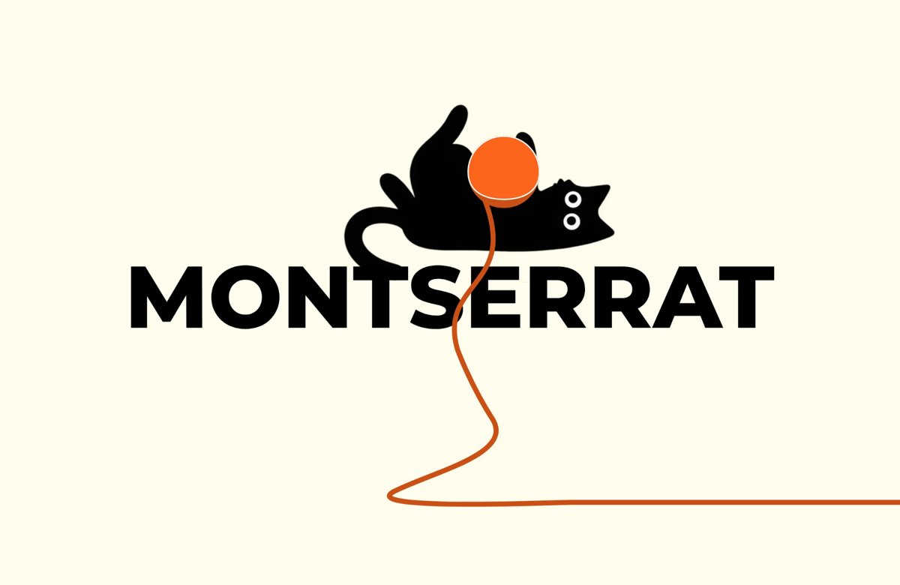

# Montserrat — шрифтовой постер

Одностраничный сайт о шрифте Montserrat: описание, глифы и цифры, анатомия, девять начертаний и поддержка языков. Каждое начертание «играет» чёрный кот; всё оформлено в оранжевых и чёрных цветах на кремовом фоне.

## Ссылка на сайт

[https://imbirechka.github.io/Montserrat/]

## Скриншот

## Автор

Паученко Дарья, группа Б26Д309.

Кураторы: Цветников Николай, Комкова Анна.

## Что я научился(ась) делать

- [Создавать структуру одностраничного сайта и организовывать информацию по тематическим секциям]
- [Использовать HTML и CSS для реализации дизайна сайта, а также применять ИИ для написания и корректировки кода.]
- [Работать с типографикой: изучать анатомию букв шрифта Montserrat, подбирать начертания и выстраивать визуальную иерархию текста.]

Макет (иллюстрации котов, нитки, раскладка секций) нарисован мной в графическом редакторе и экспортирован в SVG. Код сайта написан с помощью ИИ (см. ниже).

## Использование ИИ

### Инструменты

| Инструмент | Для чего использовала | Уровень помощи |

| Claude | Помог с корректировкой шрифта Montserrat, подбором начертаний и настройкой типографики, а также с написанием и исправлением HTML- и CSS-кода. | 3

Макет сайта, иллюстрации котов, композиция и тексты созданы мной. Я обращалась к ИИ, когда не понимала, как правильно реализовать отдельные элементы проекта с помощью кода.

### Записи о запросах

#### Запись №1 · 25.10.2026

- **Что я хотела сделать:** разобраться, как правильно перенести свой макет в HTML и оформить его с помощью CSS.
- **Что я спросила:** «как организовать структуру страницы, разместить изображения и текст, а также исправить ошибки в коде.».
- **Что ответил ИИ:** предложил варианты написания кода и объяснил, как подключать стили, изображения и отдельные секции страницы..
- **Что я изменила:** адаптировала предложенные решения под свой макет и уточняла отдельные моменты, если результат отличался от задуманного.
- **Как я поняла, что это работает:** проверяла отображение элементов и соответствие сайта своему макету.

### Выводы

ИИ помог мне разобраться с техническими вопросами при создании сайта по моему макету. С его помощью я смогла решить некоторые проблемы с кодом и понять, как правильно подключать изображения и оформлять элементы страницы. Не все предложенные решения сразу работали правильно, поэтому приходилось искать ошибки и корректировать код. В результате я лучше поняла, как устроены HTML и CSS и как с их помощью можно реализовать собственный дизайн.
